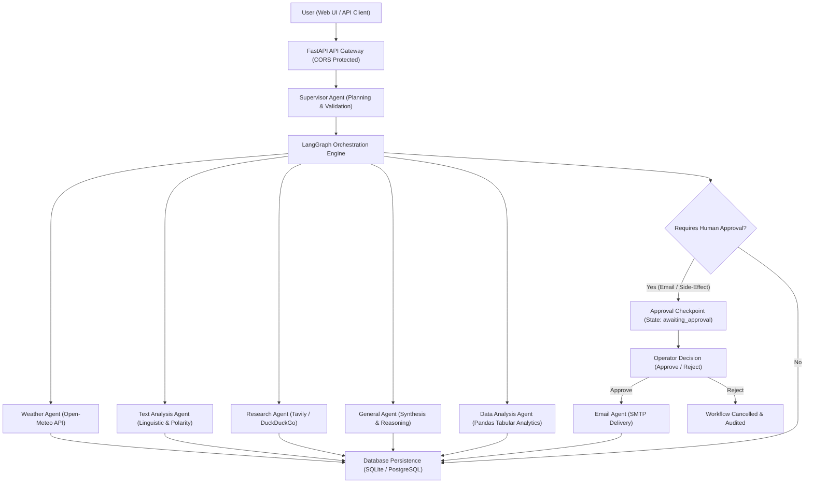

# AI Task Agent — Enterprise Multi-Agent AI Workflow Platform

AI Task Agent is an intelligent, full-stack workflow automation platform that allows users to submit natural-language goals and orchestrates execution through specialized AI agents and real deterministic tools.

Built on **FastAPI**, **LangGraph**, **Groq LLM**, **SQLAlchemy**, and a **React 19 + TypeScript + Vite** web interface, it enforces strict human-in-the-loop approvals for sensitive operations, provides persistent execution audits, and delivers verified results without fabricated metrics.

---

## 1. System Architecture



---

## 2. Multi-Agent Ecosystem

| Agent | Responsibilities | Associated Tools | Approval Required | Status |
| :--- | :--- | :--- | :---: | :---: |
| **Supervisor Agent** | Goal decomposition, tool validation, agent routing, plan generation | `create_plan`, `validate_plan` | No | **Active** |
| **Weather Agent** | Real-time meteorological data & forecasts for global cities | `get_weather` (Open-Meteo) | No | **Active** |
| **Text Analysis Agent** | Deterministic metrics, keyword extraction, word length, sentiment | `analyze_text` | No | **Active** |
| **General Agent** | Question answering, conceptual explanation, cross-step synthesis | `synthesize_response` | No | **Active** |
| **Email Agent** | Address validation, preview formatting, SMTP email delivery | `preview_email`, `send_email` | **YES** | **Active** |
| **Research Agent** | Real-time web search and verified source citation | `search_web` (Tavily/DDG) | No | **Active** |
| **Data Analysis Agent** | Safe CSV parsing, column metrics, distributions, chart data | `analyze_tabular_data` | No | **Active** |
| **Code Execution Agent** | Isolated sandbox for executing custom Python scripts | `execute_code` | **YES** | **Disabled** *(Host Security Policy)* |

> [!NOTE]
> **Code Execution Policy**: The code execution agent is intentionally marked disabled until an isolated container runtime (such as Docker or gVisor) is configured, preventing arbitrary code execution on the host server.

---

## 3. Human-in-the-Loop (HITL) Security Model

Sending emails and executing external mutations are protected side effects:
1. **Server-Side Enforcement**: The backend independently enforces approval requirements; hiding a frontend button does not grant authorization.
2. **Safe Previews**: When an action like email transmission is scheduled, the agent generates a preview (`awaiting_approval`) with recipient, subject, and body length, pausing workflow execution.
3. **Audit Trail**: Every approval and rejection is recorded with timestamp, operator notes, and status (`approved`, `rejected`).
4. **Resumption**: When an operator approves via the UI or API, execution resumes with the approved step parameters. If rejected, the workflow transitions to `cancelled` and no email is sent.

---

## 4. REST API Specification

### Workflow Management
- `POST /api/workflows/run` — Submit a natural-language goal for planning and execution.
- `GET /api/workflows/history` — Paginated workflow audit history with `limit`, `offset`, `status`, and `search` filters.
- `GET /api/workflows/history/{run_id}` — Inspect execution details, plan, step metrics, and error logs.
- `POST /api/workflows/{run_id}/cancel` — Cancel an in-flight or awaiting-approval workflow.
- `POST /api/workflows/{run_id}/retry` — Safely retry a failed or cancelled execution.

### Approvals & Governance
- `GET /api/approvals` — List pending actions requiring human approval.
- `POST /api/approvals/{approval_id}/approve` — Authorize a protected action and resume execution.
- `POST /api/approvals/{approval_id}/reject` — Reject a protected action and cancel the workflow.

### Registry & Observability
- `GET /api/agents` — Retrieve all registered agents, capabilities, tools, and operational status.
- `GET /api/analytics` — Platform metrics calculated directly from persistent database records.
- `GET /api/settings/status` — Safe integration status without leaking secret credentials.
- `POST /api/data/analyze` — Safely analyze tabular CSV datasets with summary statistics.
- `GET /health` & `GET /` — Service health checks and root metadata.

---

## 5. Local Setup & Execution Guide

### Prerequisites
- Python 3.11+
- Node.js 18+ and npm
- Windows PowerShell (or Linux/macOS bash)

### 1. Backend Setup

```powershell
# Navigate to repository root
cd C:\Users\RTX\ai-task-agent

# Activate virtual environment
.\.venv\Scripts\Activate.ps1

# Install / update backend dependencies
python -m pip install -r requirements.txt

# Configure environment variables
# Copy template if .env does not exist:
# cp .env.example .env

# Run FastAPI backend on port 8000 (or 8001)
python -m uvicorn app.main:app --host 127.0.0.1 --port 8000 --reload
```

Backend Swagger documentation will be available at:
`http://127.0.0.1:8000/docs`

### 2. Frontend Setup

```powershell
# Navigate to frontend directory
cd C:\Users\RTX\ai-task-agent\frontend

# Install dependencies
npm install

# Start development server
npm run dev
```

The web interface will launch at:
`http://localhost:5173`

---

## 6. Testing & Quality Assurance

Automated tests cover API endpoints, agent validation, tool execution, database persistence, and security controls:

```powershell
# Run backend test suite
cd C:\Users\RTX\ai-task-agent
python -m pytest -v

# Run frontend type-check and production build
cd C:\Users\RTX\ai-task-agent\frontend
npm run build
```

---

## 7. Security Principles

- **No Secret Leakage**: Secrets reside exclusively in `.env` (ignored by git). The `/api/settings/status` endpoint exposes configuration state without credentials.
- **Untrusted Model Outputs**: LLM responses are parsed and validated against strict Pydantic models and a deterministic agent registry.
- **Least Privilege Tools**: External network calls feature timeouts and sanitization.
- **CORS Whitelisting**: Restricted to authorized development and deployment origins.
