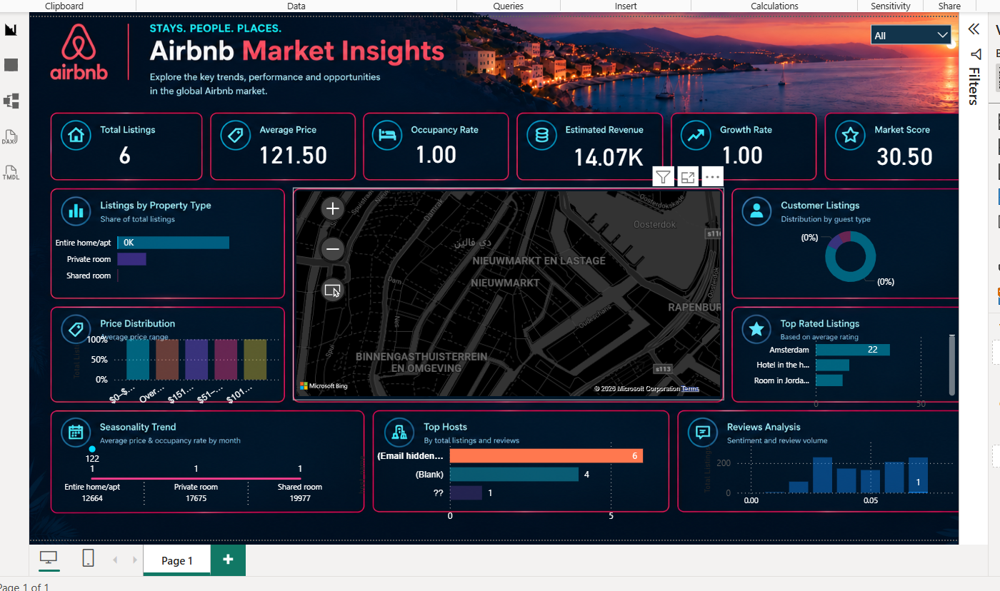

# Airbnb Market Insights Dashboard

An interactive Power BI dashboard designed to explore Airbnb listings, pricing patterns, property types, geographic distribution, host performance, and customer reviews.

## Project Overview

This project was developed as part of my data analytics training. It combines Airbnb listing data with additional data collected through web scraping to build an interactive dashboard that provides an overview of the short-term rental market.

The dashboard transforms raw data into visual insights, helping users explore listing characteristics, price distributions, location patterns, host activity, and review-related metrics.

##  Dashboard Preview

##  Project Objectives

- Explore Airbnb listings across different locations and neighborhoods.
- Analyze average prices and price distributions.
- Compare listings by property and room type.
- Visualize the geographic distribution of listings.
- Explore host performance and listing activity.
- Analyze available ratings and customer review metrics.
- Build an interactive dashboard with a consistent, professional dark theme.

## Dashboard Features

### Key Performance Indicators (KPIs)

- **Total Listings** — Overview of the number of listings in the dataset.
- **Average Price** — Average listing price based on the available data.
- **Occupancy Rate** — Indicator intended to explore listing occupancy, depending on the available data and calculation method.
- **Estimated Revenue** — Estimated revenue based on the defined business logic and available data.
- **Growth Rate** — Growth indicator where suitable time-based comparison data is available.
- **Market Score** — A calculated indicator based on the project's selected market metrics.

### Listings by Property Type

Compares Airbnb listings across different property or room categories to understand the distribution of accommodation types.

### Geographic Listing Distribution

Uses a map to explore the geographic distribution of listings and identify areas with higher listing concentrations.

### Price Distribution

Groups listings into price ranges to help explore pricing patterns and compare different segments of the market.

### Customer Listings

Visualizes listing distribution by selected categories, such as guest or accommodation type, depending on the available fields.

### Top Rated Listings

Highlights listings based on available rating information to help explore highly rated accommodations.

### Seasonality Trend

Provides a dedicated area for exploring changes over time when suitable historical or date-based data is available.

### Top Hosts

Supports the exploration of host activity using available listing and review metrics.

### Reviews Analysis

Provides a space to analyze review volume and available customer feedback metrics.

##  Tools & Technologies

- **Power BI Desktop** — Interactive dashboard development.
- **Power Query** — Data transformation and preparation.
- **Web Scraping** — Collection of additional relevant data.
- **Data Modeling** — Organizing listing data and related dimension tables.
- **Data Visualization** — Presenting data through KPIs, charts, and geographic maps.
- **DAX** — Creating measures and calculated metrics where applicable.

##  Project Workflow

1. Collected the Airbnb dataset.
2. Scraped additional relevant data to enrich the original dataset.
3. Combined and prepared the collected data.
4. Organized the data model and related dimensions.
5. Created measures and calculated metrics for the dashboard.
6. Designed the dashboard layout and selected suitable visualizations.
7. Built an interactive Power BI report with a dark-themed design.

##  Project Files

- `Airbnb-Market-Insights.pbix` — Power BI dashboard report.
- `airbnb-dashboard.png` — Dashboard preview image.
- `README.md` — Project documentation.

*The Power BI report may be shared through an external download link if its file size exceeds GitHub's regular upload limit.*

## Key Learnings

- Working with real-world datasets and web-scraped data.
- Combining and preparing data from multiple sources.
- Structuring data for analysis and visualization.
- Creating Power BI measures and calculated metrics.
- Designing interactive dashboards and KPI cards.
- Presenting analytical information through charts and geographic maps.

##  Author

**Fares Elgohary**

- GitHub: [fareselgohary2003](https://github.com/fareselgohary2003)
- LinkedIn: [Fares Elgohary](https://linkedin.com/in/fares-elgohary-91ba22380)

---

*Developed as part of my data analytics training.*
