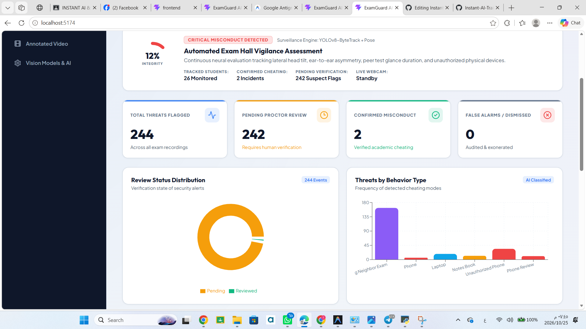
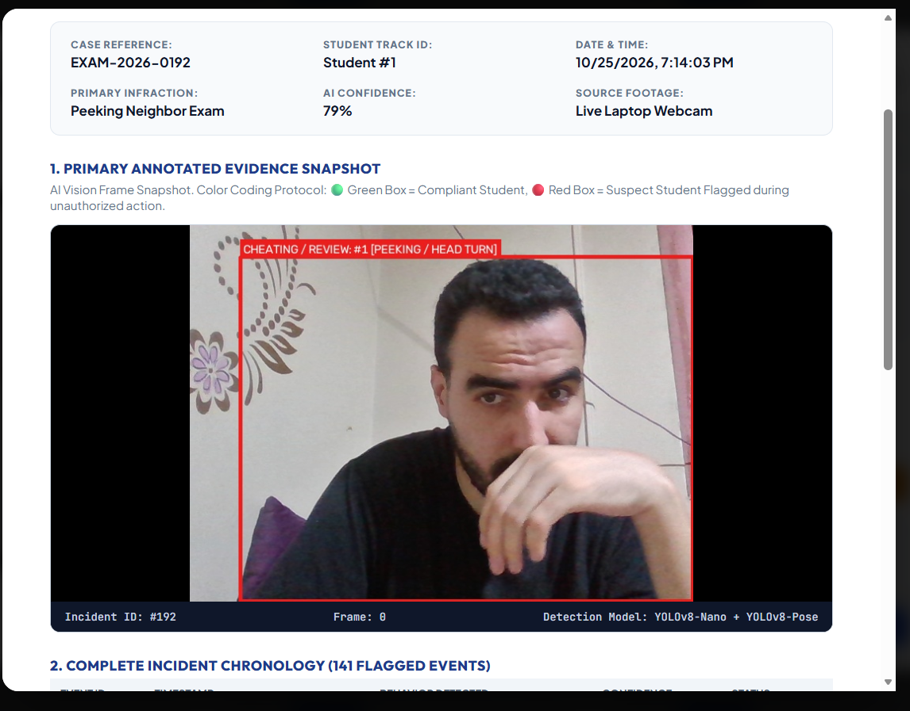
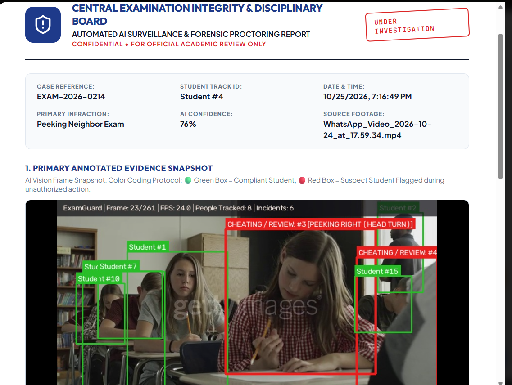
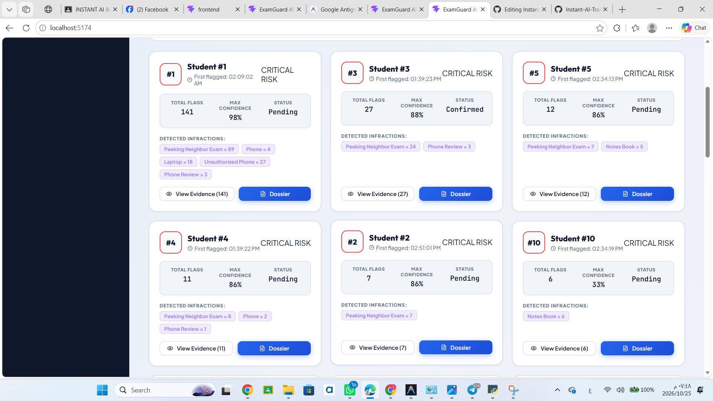
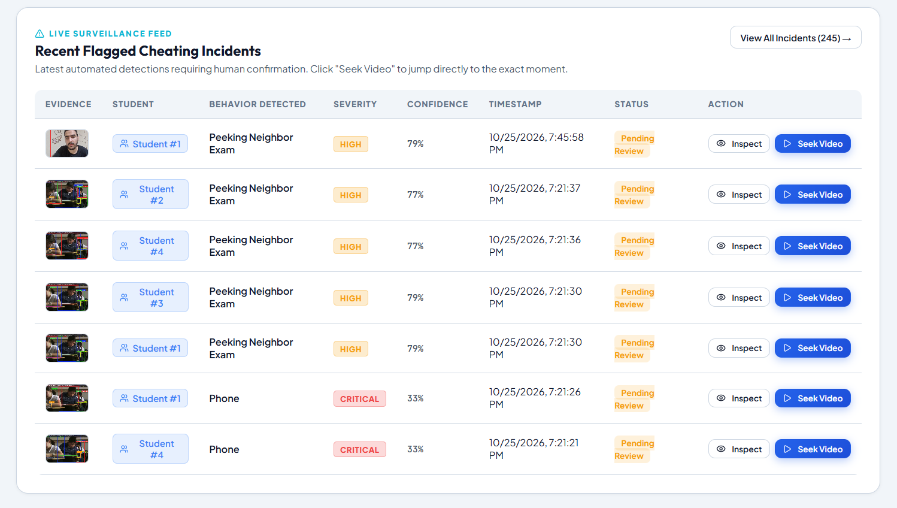
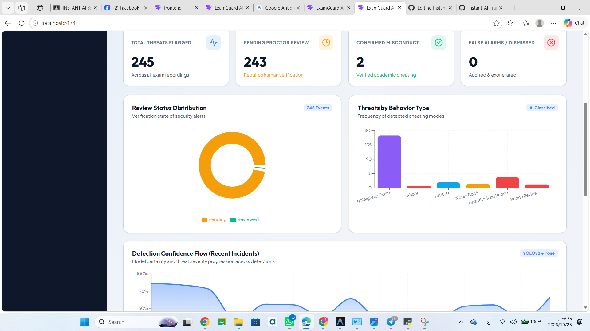

# ExamGuard — AI-Powered Exam Monitoring System

An AI-powered exam monitoring system designed to support exam supervision through real-time camera monitoring, automated visual detection, incident tracking, and a centralized dashboard.

ExamGuard combines computer vision, desktop applications, video processing, and web-based analytics to help make exam monitoring more organized, transparent, and efficient.

## Project Overview

ExamGuard is designed to assist exam supervisors in monitoring examination sessions using computer vision and automated detection workflows.

The system supports live camera monitoring, uploaded video processing, detection visualization, incident history, and evidence review through desktop interfaces and a web dashboard.

## Project Preview

### 1. Desktop Application Overview

The main desktop interface for accessing ExamGuard's monitoring and review features.



### 2. Live Camera Monitoring

Monitor a live camera feed and visualize detections during a monitoring session.



### 3. Uploaded Video Processing

Process recorded videos and review the resulting visual detection output.



### 4. AI Detection Results

View detection results and visual annotations generated by the computer vision pipeline.



### 5. Incident History and Evidence Review

Review recorded incidents and inspect available evidence from previous monitoring sessions.



### 6. Web Dashboard

Access a dashboard designed to present monitoring information and supporting visual analytics.



## Key Features

### AI-Powered Visual Monitoring
- Computer vision-based detection using YOLO.
- Live camera monitoring.
- Video processing and visualized detection results.
- Object tracking support through ByteTrack integration.

### Incident Management
- Incident history and review workflows.
- Visual evidence and detection-result inspection.
- Organized access to monitoring outputs.
- Alert-related project components.

### Desktop Applications
- Desktop monitoring interface.
- Qt-based desktop application.
- Separate desktop application implementation.
- Dedicated views and interface components within the project.

### Web Dashboard
- React-based frontend.
- Dashboard-oriented presentation of monitoring information.
- Data visualization components.
- Additional interface components for reviewing relevant information.

### Data and Processing
- SQLite-based database layer.
- Configurable application settings.
- Organized directories for logs, uploads, alerts, and processing outputs.
- Automated visual processing workflows.

## Technology Stack

| Technology | Purpose |
|---|---|
| Python | Core application and processing logic |
| YOLO | Computer vision and object detection |
| ByteTrack | Object tracking |
| FastAPI | API framework, where enabled by the application configuration |
| SQLite | Local data storage |
| PySide6 / Qt | Desktop user interface |
| Tkinter | Alternative desktop interface |
| React | Web user interface |
| Vite | Frontend development and build tooling |
| JavaScript / JSX | Frontend components |
| CSS | Interface styling |

## System Architecture

ExamGuard is organized into several components:

1. **Detection and Processing:** Runs the computer vision workflow for camera feeds and recorded videos.
2. **Tracking and Visualization:** Supports object tracking and visual presentation of detection results.
3. **Desktop Applications:** Provides interfaces for monitoring, processing, and reviewing incidents.
4. **Data Layer:** Uses SQLite and supporting Python modules for data persistence.
5. **Web Dashboard:** Presents monitoring-related information through a browser-based interface.
6. **Supporting Modules:** Organizes alerts, logs, uploads, outputs, and tests.

## Project Structure

The following structure reflects the main files and directories in the repository. Some implementation details are contained within the subdirectories.

```text
ExamGuard — AI-Powered Exam Monitoring System/
│
├── alerts/
├── core/
├── desktop/
├── desktop_qt/
├── frontend/
├── logs/
├── outputs/
├── tests/
├── uploads/
│
├── .gitignore
├── README.md
├── config.py
├── database.py
├── main.py
├── desktop_app.py
├── desktop_app_qt.py
├── review_incidents.py
├── test_yolo.py
├── requirements.txt
│
├── examguard-overview.png.png
├── live-camera.png.png
├── video-processing.png.png
├── detection-results.png.png
├── incident-history.png.png
└── web-dashboard.png.png
```

## Installation

### Prerequisites

Before running the project, make sure you have:

- Python installed.
- Node.js and npm installed if you want to run the web frontend.
- A compatible camera if you want to use live monitoring.
- The required Python dependencies.
- Any additional model weights or configuration files required by your local setup.

### 1. Clone the Repository

```bash
git clone https://github.com/fareselgohary2003/Instant-AI-Training.git
```

Navigate to the ExamGuard project directory:

```bash
cd "Instant-AI-Training/ExamGuard — AI-Powered Exam Monitoring System"
```

### 2. Set Up the Python Environment

Create a virtual environment:

```bash
python -m venv .venv
```

Activate it on Windows:

```powershell
.venv\Scripts\Activate.ps1
```

If PowerShell blocks activation, you can use Command Prompt:

```bat
.venv\Scripts\activate.bat
```

### 3. Install Dependencies

```bash
python -m pip install --upgrade pip
pip install -r requirements.txt
```

Some features may require additional model weights, environment settings, or external components according to the project configuration.

## Running the Application

ExamGuard includes multiple entry points for its desktop and backend components.

### Desktop Application

For the Qt-based desktop interface:

```bash
python desktop_app_qt.py
```

For the alternative desktop interface:

```bash
python desktop_app.py
```

### Backend

If `main.py` exposes the FastAPI application as `app`, the backend can be started with:

```bash
uvicorn main:app --reload
```

If your local configuration uses a different application entry point, use the corresponding module and application name.

### Web Frontend

Open a terminal and navigate to the frontend directory:

```bash
cd frontend
npm install
npm run dev
```

Vite will display the local development URL in the terminal.

**Note:** Run only the components you need. The exact startup sequence depends on how the local configuration connects the desktop application, backend, and frontend.

## Testing

The repository includes test-related files and a `tests/` directory.

To run the project's Python tests, execute:

```bash
python -m pytest
```

To test the YOLO setup separately:

```bash
python test_yolo.py
```

Test availability depends on the installed dependencies, configured model weights, and local environment.

## Configuration

Application settings are managed through `config.py`.

Database-related functionality is organized in `database.py`.

Before using the system, verify that:

- Required model weights are available.
- The camera or video source is accessible.
- The application has permission to access required files and devices.
- Required directories and configuration values are correctly set.
- The database can be initialized by the application.

Do not commit passwords, API keys, private data, or other sensitive configuration values to the repository.

## Use Cases

ExamGuard can support workflows such as:

- Assisting supervisors during examination sessions.
- Monitoring live camera feeds.
- Processing recorded examination videos.
- Reviewing visual detection results.
- Organizing incidents and available evidence.
- Presenting monitoring information through a web dashboard.

ExamGuard is intended as a monitoring aid. Automated detections should be reviewed by a human before making consequential decisions about a student.

## Future Improvements

Potential areas for future development include:

- Expanded detection and tracking capabilities.
- Improved incident classification and review workflows.
- More detailed analytics and reporting.
- Enhanced dashboard visualizations.
- Better configuration and deployment workflows.
- Additional testing and documentation.

## Author

**Fares Elgohary**

GitHub: [@fareselgohary2003](https://github.com/fareselgohary2003)

## License

No license is specified in this README. Refer to the repository's license file, if available, before redistributing or using the project.

---

**ExamGuard — AI-Powered Exam Monitoring System**

*Computer vision. Exam monitoring. Incident review.*
