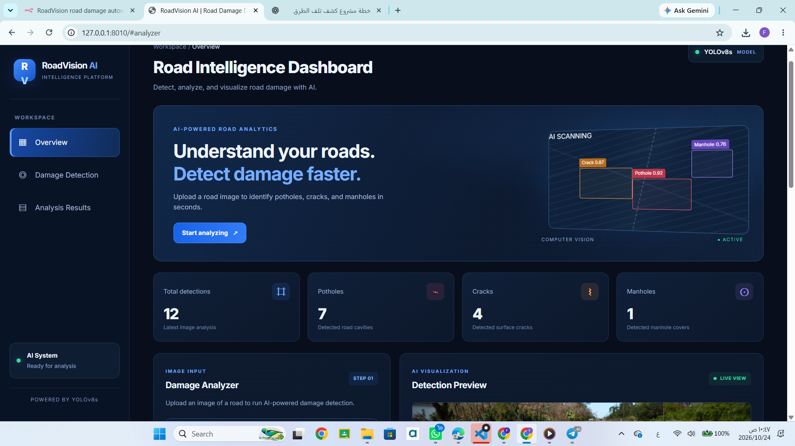
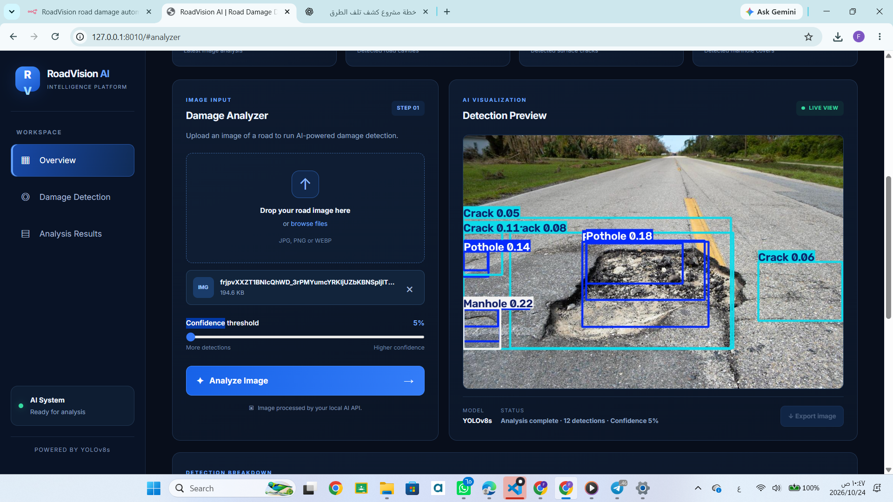
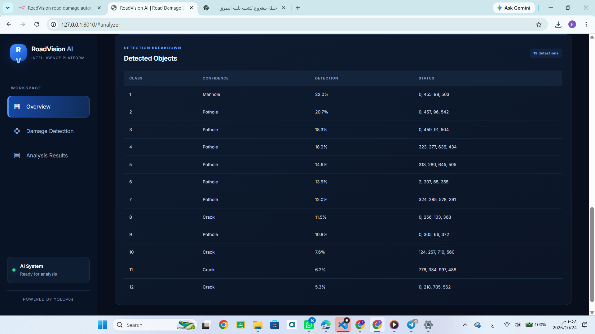
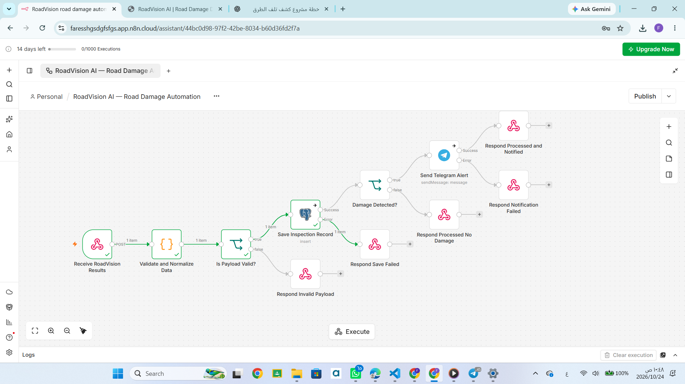
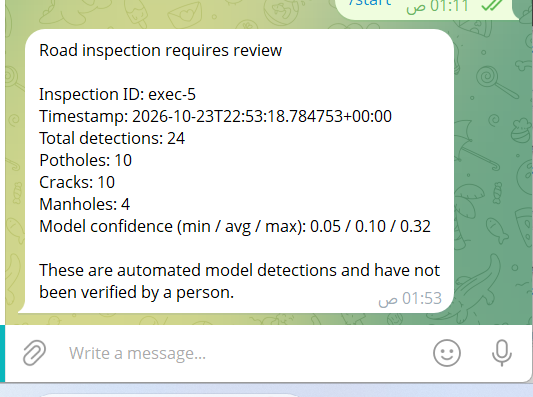

# RoadVision AI — Road Damage Detection & Automation

RoadVision AI is an AI-powered road damage detection and workflow automation project. It combines computer vision, a FastAPI backend, a web dashboard, n8n automation, PostgreSQL, and Telegram notifications.

The system uses a trained YOLOv8 model to detect potholes, cracks, and manholes in road images. Detection results are processed by the backend and can be sent to an n8n workflow for conditional processing, database storage, and Telegram notifications.

## Key Features

- AI-powered road damage detection using a trained YOLOv8 model.
- Image upload and detection results through a web dashboard.
- FastAPI backend for application and inference requests.
- Webhook integration with n8n Cloud.
- Conditional workflow automation.
- PostgreSQL integration for detection records.
- Telegram bot notifications.
- Model training using a Kaggle Notebook with GPU acceleration.

## Screenshots

### Web Dashboard



### Detection Results



### Image Upload Interface



### n8n Automation Workflow



### Telegram Notification



## System Architecture

The system connects image-based AI inference with an automated backend workflow.

1. The user uploads a road image through the dashboard.
2. The trained YOLOv8 model detects supported classes.
3. FastAPI processes the request and prepares the detection results.
4. The backend sends structured detection data to an n8n webhook.
5. n8n processes the incoming data using configured workflow logic.
6. PostgreSQL stores detection records.
7. Telegram sends notifications according to the workflow configuration.

```text
Road Image
    |
    v
Web Dashboard
    |
    v
FastAPI Backend
    |
    v
YOLOv8 Model
    |
    v
Detection Results
    |
    v
n8n Webhook
    |
    v
Conditional Processing
    |
    +--------------------+
    |                    |
    v                    v
PostgreSQL          Telegram Bot
```

## Technology Stack

| Component | Technology |
|---|---|
| Programming Language | Python |
| Object Detection | YOLOv8 |
| Model Framework | Ultralytics |
| Model Training | Kaggle Notebook with GPU |
| Backend | FastAPI |
| Frontend | HTML, CSS, JavaScript |
| Workflow Automation | n8n Cloud |
| API Integration | Webhooks |
| Database | PostgreSQL |
| Notifications | Telegram Bot API |
| Version Control | Git and GitHub |

## Supported Detection Classes

| Class | Description |
|---|---|
| Pothole | Road surface holes and localized damage |
| Crack | Visible cracks in road surfaces |
| Manhole | Manholes and related road-surface structures |

Detection performance depends on the trained model, input image quality, and inference configuration.

## Repository Files

The repository includes the following project assets:

- `main.py` — FastAPI backend.
- `best.pt` — trained object detection model weights.
- `road_damage_comparison.csv` — road damage comparison data.
- `RoadVision AI — Road Damage Automation.json` — exported n8n workflow.
- `dashboard-ui.png.png` — dashboard screenshot.
- `detection-results.png.png` — detection results screenshot.
- `upload-interface.png.png` — image upload screenshot.
- `n8n-workflow.png.png` — workflow screenshot.
- `telegram-notification.png.png` — Telegram notification screenshot.

The web interface files should be included in the `static/` directory if the backend depends on them. A `requirements.txt` file should also be included to document the Python dependencies.

## Installation

### Prerequisites

- Python
- pip
- The trained model weights
- An accessible n8n instance or n8n Cloud account
- PostgreSQL configuration
- Telegram bot configuration

### 1. Clone the Repository

```bash
git clone https://github.com/fareselgohary2003/RoadVision-AI.git
cd RoadVision-AI
```

### 2. Create a Virtual Environment

On Windows:

```powershell
python -m venv .venv
.venv\Scripts\Activate.ps1
```

On macOS or Linux:

```bash
python3 -m venv .venv
source .venv/bin/activate
```

### 3. Install Dependencies

Once `requirements.txt` is included in the repository, install the required packages:

```bash
pip install -r requirements.txt
```

### 4. Configure the Model

Ensure that `best.pt` is located at the path expected by the application.

### 5. Configure n8n

Import the exported workflow JSON into n8n and configure the webhook, PostgreSQL connection, and Telegram bot credentials.

Do not publish credentials or private webhook URLs in the repository.

## Running the Application

If the FastAPI application instance in `main.py` is named `app`, run:

```bash
uvicorn main:app --reload
```

Open the local URL displayed in the terminal. The dashboard route depends on the application configuration.

For end-to-end automation, make sure the n8n workflow is active and its integrations are configured correctly.

## Workflow Automation

The n8n workflow connects the detection backend to downstream processing.

Depending on the configured workflow, it can:

- Receive detection data through a webhook.
- Process detection information.
- Apply conditional logic.
- Store records in PostgreSQL.
- Send Telegram notifications.

The exported workflow JSON can be used for documentation and workflow reuse. Credentials should be configured securely after importing the workflow.

## Model Training

The object detection model was trained using a Kaggle Notebook with GPU acceleration. The resulting trained weights are used for inference on uploaded road images.

The supported detection classes are potholes, cracks, and manholes.

## Security

- Never commit API keys, Telegram bot tokens, or database passwords.
- Do not upload `.env` files containing secrets.
- Review exported workflow JSON files for sensitive configuration.
- Exclude virtual environments, caches, and temporary files.
- If `best.pt` exceeds GitHub's 100 MB standard file limit, use Git LFS or external model hosting.

## Future Improvements

- Real-time detection from video streams.
- Geolocation tagging for road defects.
- Historical detection analytics.
- Road damage severity estimation.
- Map-based visualization of detected defects.
- Cloud deployment and integration with road maintenance systems.

## Author

**Fares Elgohary**

AI Agentic & Automation Engineer

- [GitHub](https://github.com/fareselgohary2003)
- [LinkedIn](https://www.linkedin.com/in/fares-elgohary-91ba22380/)
- [Kaggle](https://www.kaggle.com/elgohary249)

---

RoadVision AI demonstrates the integration of computer vision, backend API development, workflow automation, database storage, and messaging integrations.
